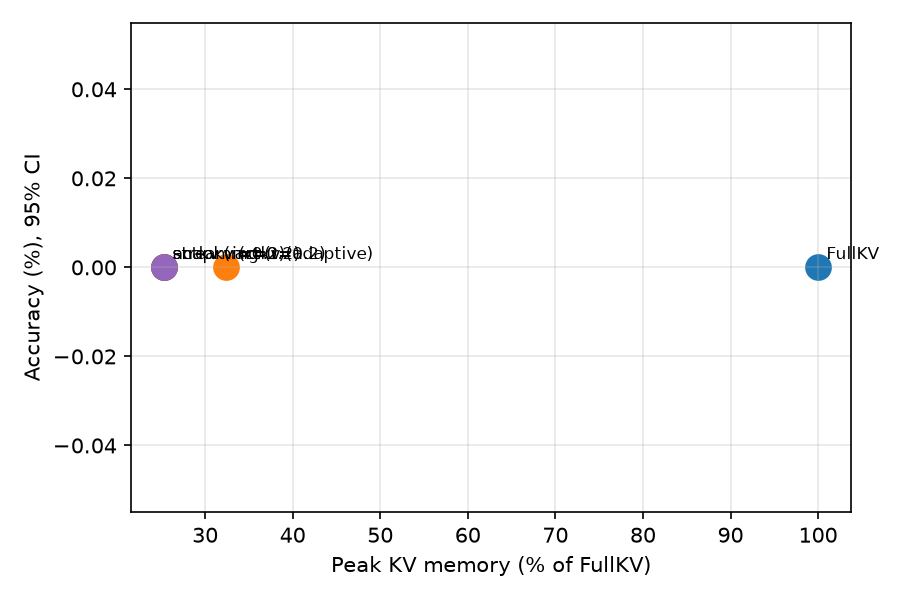
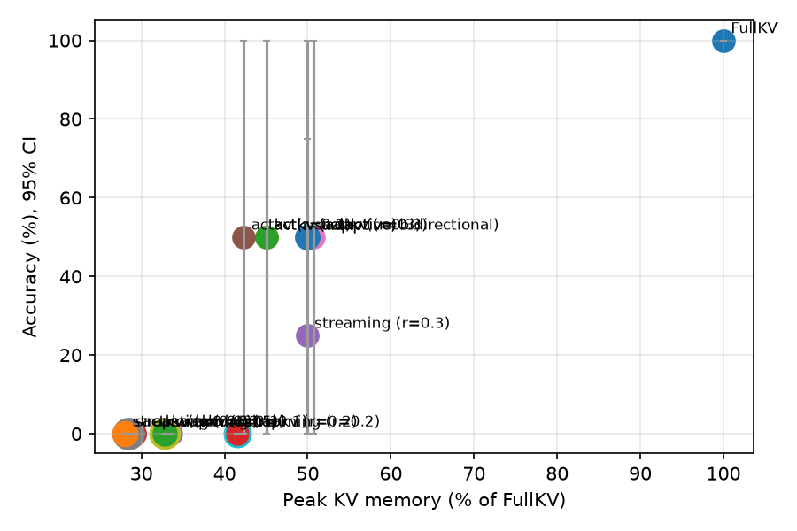

# actkv-open

An unofficial, open-source implementation of **ActKV: Efficient LLM Agents through Action-Guided KV Cache Management** (Wang et al., [arXiv:2609.31395](https://arxiv.org/abs/2609.31395)). The paper ships no code. This repo implements all three components, with Triton kernels, a Hugging Face backend for agent experiments, baselines, and an eval harness.

## The idea in one paragraph

Agents run observation, reasoning, action (ORA) loops, so the KV cache grows every round. Only action tokens change the environment, and the paper finds that the KV entries actions attend to are (1) different from the ones observation and reasoning tokens attend to and (2) stable across rounds. ActKV therefore scores entries by **action-region attention**, keeps them with an attention-aware **LRFU** policy, grows the budget when the model's **confidence trends down**, and makes token-level eviction real on paged memory with two kernels: **LSE-recovery scoring** and **conflict-free in-place compaction**.

## What's here

| Paper | Code | Status |
|---|---|---|
| Alg. 1, action-oriented LRFU eviction | `actkv/eviction.py::ActionLRFU` | unit-tested against hand-worked examples |
| Alg. 2, confidence-driven budget | `actkv/budget.py::ConfidenceBudget` | unit-tested |
| Alg. 3, LSE-recovery attention kernel | `actkv/kernels/lse_attn.py` (Triton + torch ref) | matches the torch reference under the Triton interpreter (`scripts/test_interpreter.sh`); not yet run on a GPU |
| Alg. 4, in-place compaction kernel | `actkv/kernels/compaction.py` (Triton + torch ref) | conflict-freedom, data integrity and block reclamation tested; Triton kernel checked under the interpreter only |
| Paged KV cache (vLLM-style layout) | `actkv/paged.py` | standalone model of the per-layer layout and block tables, tested; not a vLLM integration |
| Scores → keep mask → compaction (paged) | `actkv/paged.py::PagedKVCache.evict` | tested |
| Baselines: FullKV, SnapKV, StreamingLLM | `actkv/eviction.py` | implemented; tests check shapes, prefix retention and that compression happens |
| ReAct agent + HF backend | `actkv/hf/session.py`, `actkv/agent/` | logits after eviction match masked full attention to 1e-4 on tiny random models |
| Fig. 6 access-pattern study | `actkv/analysis.py`, `scripts/access_patterns.py` | recording and classification tested |
| Table 1 kernel benchmark | `benchmarks/bench_kernels.py` | like-for-like baseline, measured memory, JSON output; real numbers need a CUDA GPU |
| **Extension:** bidirectional budget | `BudgetConfig(bidirectional=True)` | tested, not in the paper |

R-KV is not included yet.

## Install

```bash
pip install -e ".[triton,dev]"            # triton installs on Linux only; + ".[eval]" for plots, ".[alfworld]" for ALFWorld
pytest                                    # without triton (macOS) the kernel-vs-reference tests skip
scripts/test_interpreter.sh               # runs those kernel tests under the Triton interpreter in Linux Docker
```

## Run

The full GPU evaluation (tests with real Triton, the kernel benchmark, the eval sweeps, summary tables with confidence intervals, and this README's results section) is one resumable command; see [RUNPOD.md](RUNPOD.md):

```bash
bash scripts/run_a100.sh              # on a CUDA GPU
bash scripts/run_a100.sh --dry-run    # the same pipeline on CPU with a tiny random model
```

The pieces, individually:

```bash
# 1. FullKV reference (also gives per-task trace lengths for ratio budgets)
python scripts/run_eval.py --model Qwen/Qwen3-8B --env vault --method full --n-tasks 50 --runs 3 \
    --out results/full.jsonl

# 2. ActKV with the adaptive budget
python scripts/run_eval.py --model Qwen/Qwen3-8B --env vault --method actkv --adaptive \
    --out results/actkv_adaptive.jsonl

# 3. Fixed per-trace budget ratio (Sec 8.2 protocol), any method
for m in actkv snapkv streaming; do for r in 0.05 0.1 0.2 0.3; do
  python scripts/run_eval.py --model Qwen/Qwen3-8B --env vault --method $m --budget-ratio $r \
      --full-results results/full.jsonl --out results/${m}_${r}.jsonl
done; done

# 4. Table (sample sizes, 95% bootstrap CIs, paired delta vs FullKV) + accuracy-vs-memory plot
python scripts/summarize.py --full results/full.jsonl results/*.jsonl --plot results/pareto.png

# 1-3 in one process (model loaded once): every config task by task, stopping before a time budget;
# then step 4 on results/vault
python scripts/run_eval.py --sweep configs/vault_sweep.json --out-dir results/vault --hours 3

# 5. Do action-critical entries stay stable on small models? (Fig. 6)
python scripts/access_patterns.py --model Qwen/Qwen3-8B --only-success --out results/aav_8b.json

# 6. Kernel speed and memory (Table 1 setup), on a GPU
python benchmarks/bench_kernels.py --device cuda --out results/bench_kernels.json
```

**Environments.** `vault` is an offline memory task built for this repo, with long noisy room listings. The vault code is on a note that can be read only once, the note says where a trail starts, and the vault at the end of the trail (at least `trail` + 1 rounds later) takes a single submit. The code has 170,000 possible values. `tests/test_vault.py` shows a scripted agent with memory solves every task and the same agent without memory fails every task. `alfworld` wraps the ALFWorld text env (`pip install alfworld && alfworld-download`). Task *i* is game *i* of the split in sorted order (`--alfworld-split`, default `eval_out_of_distribution`, 134 games). The data is read from `$ALFWORLD_DATA` (default `~/.cache/alfworld`) with a built-in copy of the config keys the text env needs; `--alfworld-config` takes ALFWorld's `base_config.yaml` instead. The adapter is tested with fake modules and was run on four real games, but no model has played ALFWorld through it yet.

## How the HF backend stays correct

After eviction the cache is shorter than the number of tokens seen, so the session tracks two counters: the logical position (for RoPE `position_ids`) and the physical cache length (passed as `cache_position`). Cached keys already carry their rotation, so dropping or reordering them is safe. `tests/test_hf_session.py` checks that logits after eviction match a full cache with the evicted positions masked, and that reordering the cache changes nothing (compaction depends on that), both to a tolerance of 1e-4 on tiny randomly initialised Qwen3 models. That is a numerical test, not a proof.

Whether `cache_position` matters depends on the transformers version. From 4.56 to 5.3, Qwen3 builds its causal mask from `cache_position`, so the physical counter is load-bearing and the test checks it. From 5.4 on, Qwen3 ignores `cache_position` and takes positions from the cache length, which equals the physical length after eviction anyway; there, the test can't catch a wrong `cache_position`.

Scores come from `output_attentions` on single-token decode steps, which requires `attn_implementation="eager"`. That's simple and model-agnostic but slow. The paged kernels are meant to be the fast path, but no model backend uses them yet (see Known limitations).

<!-- results:begin -->
## Results

Generated by `scripts/update_readme.py` from the files in `results/`; do not edit by hand. Run on NVIDIA A100-SXM4-80GB (torch 2.8.0+cu128, CUDA 12.8, triton 3.4.0, transformers 5.22.2), commit `2f832f7`, 2026-11-07.

### alfworld

Model `Qwen/Qwen3-8B`, thinking off, up to 1024 new tokens per round. *tasks* and *episodes* are each config's sample size. Accuracy has a 95% bootstrap CI over tasks; Δ is the paired difference from FullKV on the same tasks. Peak KV and trace length are relative to FullKV.

| config | tasks | episodes | accuracy [95% CI] | Δ vs FullKV [95% CI] | peak KV / FullKV | trace / FullKV |
|---|---:|---:|---:|---:|---:|---:|
| FullKV | 1 | 1 | 0.000 | +0.000 | 100% | 100% |
| actkv (adaptive) | 1 | 1 | 0.000 | +0.000 | 32% | 100% |
| actkv (r=0.2) | 1 | 1 | 0.000 | +0.000 | 25% | 100% |
| snapkv (r=0.2) | 1 | 1 | 0.000 | +0.000 | 25% | 100% |
| streaming (r=0.2) | 1 | 1 | 0.000 | +0.000 | 25% | 100% |



### vault

Model `Qwen/Qwen3-8B`, thinking off, up to 1024 new tokens per round. *tasks* and *episodes* are each config's sample size. Accuracy has a 95% bootstrap CI over tasks; Δ is the paired difference from FullKV on the same tasks. Peak KV and trace length are relative to FullKV.

| config | tasks | episodes | accuracy [95% CI] | Δ vs FullKV [95% CI] | peak KV / FullKV | trace / FullKV |
|---|---:|---:|---:|---:|---:|---:|
| FullKV | 4 | 4 | 1.000 [1.00, 1.00] | +0.000 [0.00, 0.00] | 100% | 100% |
| actkv (adaptive) | 4 | 4 | 0.500 [0.00, 1.00] | -0.500 [-1.00, 0.00] | 45% | 100% |
| actkv (adaptive, bidirectional) | 4 | 4 | 0.500 [0.00, 1.00] | -0.500 [-1.00, 0.00] | 45% | 100% |
| actkv (r=0.05) | 4 | 4 | 0.000 [0.00, 0.00] | -1.000 [-1.00, -1.00] | 29% | 102% |
| actkv (r=0.1) | 4 | 4 | 0.000 [0.00, 0.00] | -1.000 [-1.00, -1.00] | 34% | 99% |
| actkv (r=0.2) | 4 | 4 | 0.500 [0.00, 1.00] | -0.500 [-1.00, 0.00] | 42% | 99% |
| actkv (r=0.3) | 4 | 4 | 0.500 [0.00, 1.00] | -0.500 [-1.00, 0.00] | 51% | 99% |
| snapkv (r=0.05) | 4 | 4 | 0.000 [0.00, 0.00] | -1.000 [-1.00, -1.00] | 28% | 169% |
| snapkv (r=0.1) | 4 | 4 | 0.000 [0.00, 0.00] | -1.000 [-1.00, -1.00] | 33% | 160% |
| snapkv (r=0.2) | 4 | 4 | 0.000 [0.00, 0.00] | -1.000 [-1.00, -1.00] | 41% | 133% |
| snapkv (r=0.3) | 4 | 4 | 0.500 [0.00, 1.00] | -0.500 [-1.00, 0.00] | 50% | 112% |
| streaming (r=0.05) | 4 | 4 | 0.000 [0.00, 0.00] | -1.000 [-1.00, -1.00] | 28% | 118% |
| streaming (r=0.1) | 4 | 4 | 0.000 [0.00, 0.00] | -1.000 [-1.00, -1.00] | 33% | 110% |
| streaming (r=0.2) | 4 | 4 | 0.000 [0.00, 0.00] | -1.000 [-1.00, -1.00] | 41% | 98% |
| streaming (r=0.3) | 4 | 4 | 0.250 [0.00, 0.75] | -0.750 [-1.00, -0.25] | 50% | 100% |



### Kernel benchmark (one compression step)

NVIDIA A100-SXM4-80GB, float16, block 16, 8 KV heads, 32 query heads, head dim 128, 1 layer; median of 5 runs after 1 warm-up. Extra memory is the peak allocated during the step, measured with `torch.cuda.max_memory_allocated`.

| tokens → budget | requests | ActKV ms | gather ms | speedup | ActKV extra MB | gather extra MB | same result |
|---|---:|---:|---:|---:|---:|---:|---|
| 1024 → 512 | 1 | 1.233 | 0.725 | 0.59x | 0.1 | 6.4 | yes |
| 1024 → 512 | 4 | 4.128 | 2.707 | 0.66x | 0.2 | 12.2 | yes |
| 1024 → 512 | 16 | 15.690 | 10.661 | 0.68x | 0.5 | 12.9 | yes |
| 1024 → 512 | 64 | 61.856 | 42.457 | 0.69x | 2.3 | 14.4 | yes |
| 2048 → 1536 | 1 | 1.248 | 0.742 | 0.59x | 0.1 | 14.4 | yes |
| 2048 → 1536 | 4 | 4.290 | 2.832 | 0.66x | 0.3 | 26.7 | yes |
| 2048 → 1536 | 16 | 16.214 | 11.094 | 0.68x | 1.1 | 27.5 | yes |
| 2048 → 1536 | 64 | 63.968 | 43.822 | 0.69x | 4.2 | 30.2 | yes |
| 6144 → 4096 | 1 | 1.394 | 0.873 | 0.63x | 0.3 | 41.1 | yes |
| 6144 → 4096 | 4 | 4.753 | 3.157 | 0.66x | 0.9 | 77.4 | yes |
| 6144 → 4096 | 16 | 18.111 | 12.339 | 0.68x | 3.2 | 79.6 | yes |
| 6144 → 4096 | 64 | 71.083 | 48.572 | 0.68x | 12.5 | 88.6 | yes |

<!-- results:end -->

## Choices where the paper is ambiguous

- **Head aggregation.** Compaction moves whole slots (all heads), so each token needs one score per layer. Scores are max over the GQA group (as in Alg. 3) and then **mean over KV heads** (`head_reduce="max"` is available).
- **Per-layer keep sets, equal size (HF backend only).** Each layer picks its own top-B entries, but every layer keeps B, so a contiguous backend keeps a single sequence length. The paged path (`PagedKVCache.evict`) keeps one set for all layers, because a sequence has one block table: scores are averaged over layers.
- **Top-p hit set.** Implemented as a nucleus: per layer, the smallest set of non-protected entries holding at least 90% of the action attention, averaged over the round's action tokens.
- **Budget excludes the protected prefix.** The system prompt and task are never evicted and don't count toward B. ORA lengths and the `--budget-ratio` base (FullKV trace length) exclude them too.
- **When the adaptive budget moves.** Alg. 2 adjusts the budget only when a compression is triggered (the evictable cache exceeds the current budget), not at every round end.
- **Confidence trend window.** The slope is fit over the whole trace so far (min-pool w=64, s=8, bottom 10%).
- **When baselines compress.** SnapKV and StreamingLLM compress at every ORA boundary, and also mid-round once the cache exceeds B + slack. The slack is `--slack`, or L̄ when `--full-results` is given, taken per task: the mean FullKV ORA length of the same task, like the per-trace budget. With neither, baselines compress only at ORA boundaries. ActKV compresses only at ORA boundaries.

Defaults otherwise follow Sec. 8.1: λ=0.5, p=0.9, k=20, initial budget 512, ×1.75 scale-up, 30K cap.

## Known limitations

- Not integrated into vLLM. `actkv/paged.py` models a vLLM-style per-layer KV layout and block tables (all layers in one tensor, no prefix sharing), but no model runs on it; scheduler and block-manager hooks are future work.
- Sliding-window cache layers aren't supported by the HF backend: GPT-OSS, and Mistral checkpoints whose config sets `sliding_window`. The error is raised at the first compression, not when the session starts.
- No CI. Tests run locally; `scripts/test_interpreter.sh` covers the Triton kernels in Docker.
- Results in the paper used 20B to 235B models on 8x RTX PRO 6000. This repo targets single-GPU 4B to 8B runs, and checking whether the method holds at that scale is part of the point.

## Citation

```bibtex
@article{wang2026actkv,
  title   = {ActKV: Efficient LLM Agents through Action-Guided KV Cache Management},
  author  = {Wang, Zihan and Tang, Cheng and Gong, Lei and Wang, Chao and Lou, Wenqi and Wang, Teng and Zhou, Xuehai},
  journal = {arXiv preprint arXiv:2609.31395},
  year    = {2026}
}
```

Unofficial implementation, not affiliated with the authors. MIT licensed.
